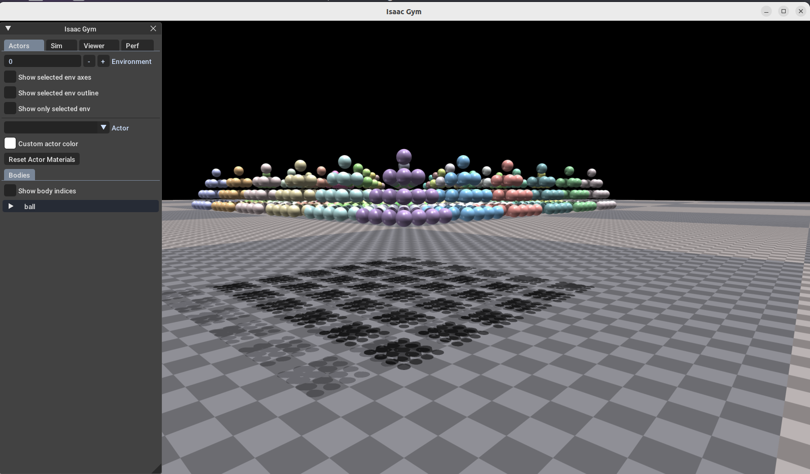

<div align="center">
  <h1 align="center">JOYIN M1 RL GYM</h1>
</div>
  <p align="center">
    <span> 🌎English </span> | <a href="README_cn.md"> 🇨🇳中文 </a>
  </p>
<p align="center">
  <strong>This is a reinforcement learning baseline repository based on the JOYNIN M1 servo robot.</strong>
</p>

<div align="center">
<table>
  <tr>
    <td></td>
    <td></td>
  </tr>
</table>
</div>

## 1. Environment Setup：

### 1\.1  Use Ubuntu 20.04 / Ubuntu 22.04, install Miniconda / Anaconda

### 1\.2  Create a virtual environment

```Plain Text
conda create -n M1_env python=3.8
```

### 1\.3  Install the graphics driver

You can use the built-in driver update tool in Ubuntu to choose a suitable driver. Version 525 or later is recommended.


### 1\.4 Install dependencies

#### 1\.4\.1 Clone the project and activate the environment

```Plain Text
cd ~/
git clone https://cnb.cool/JOYIN_RL/JOYIN_MINI_GYM
conda activate M1_env
```

#### 1\.4\.2 Install Isaac Gym

Isaac Gym is a physics simulation environment from Nvidia.

Download Isaac Gym from the Nvidia website: [https://developer.nvidia.com/isaac-gym/download](https://developer.nvidia.com/isaac-gym/download)

```Plain Text
# Clone the project and enter the project directory
cd ~/JOYIN_MINI_GYM/

# Install Isaac Gym
cd IsaacGym_Preview_4_Package/isaacgym/python/
pip install -e . -i https://mirrors.tuna.tsinghua.edu.cn/pypi/web/simple
```

Enter the following code to test. If a window appears showing 1080 balls falling, the installation was successful.
```Plain Text
cd examples
python 1080_balls_of_solitude.py
```



#### 1\.4\.3 Install rsl_rl

```Plain Text
# Enter the project directory
cd ~/JOYIN_MINI_GYM/

# Install rsl_rl
cd rsl_rl
pip install -e . -i https://mirrors.tuna.tsinghua.edu.cn/pypi/web/simple
```

#### 1\.4\.4 Install legged\_gym

```Plain Text
# Enter the project directory
cd ~/JOYIN_MINI_GYM/

# Install legged_gym
cd JOYIn_gym/
pip install -e . -i https://mirrors.tuna.tsinghua.edu.cn/pypi/web/simple
```

#### 1\.4\.4 Install legged\_gym

```Plain Text
# Install other dependencies
pip install tensorboard protobuf==3.20.3 
```

### 1\.5 Training test

Enter the code to start training. If training logs and images appear, the training framework has been installed successfully.
```Plain Text
# Enter the project directory
cd ~/JOYIN_MINI_GYM/

python JOYIn_gym/legged_gym/scripts/train.py --task=mini1_18dof_walk --num_envs=40

```
<div align="center">
<table>
  <tr>
    <td></td>
    <td></td>
  </tr>
</table>
</div>

### 1\.6 Common errors

If the following error occurs, it is because the conda environment is not linked to the python3.8 library.
```Plain Text
ImportError: libpython3.8.so.1.0: cannot open shared object file: No such file or directory
```

Find the path where the dynamic library exists:

```Plain Text
find / -name "libpython3.8.so.1.0" 2>/dev/null
```

Relink the dynamic library to resolve the issue, where /path/to/lib is your own library path:
```Plain Text
export LD_LIBRARY_PATH=/path/to/lib:$LD_LIBRARY_PATH
```

## 2.  Project Structure：

### 2\.1 Main structure of JOYIN_MINI_GYM

```Plain Text
├── IsaacGym_Preview_4_Package   # isaacgym directory
├── JOYIn_gym                    # Main project directory
├── LICENSE                
├── README.md
└── rsl_rl                       # Reinforcement learning algorithm library
```

### 2\.2 JOYIn\_gym 主要结构

```Plain Text
├── legged_gym                   # Main environment configuration files
├── LICENSE
├── licenses
├── logs                         # Training log storage path
├── resources                    # URDF storage path, you can add your own robot here
└── setup.py

```

### 2\.3 legged\_gym 主要结构

```Plain Text
├── envs                         # Environment parameter configuration
│   ├── base                     # Basic environment configuration
│   ├── __init__.py
│   ├── mini1                    # Robot training parameter configuration, inherited from base
│   └── __pycache__
├── __init__.py                  # Register training tasks
├── __pycache__
│   └── __init__.cpython-38.pyc
├── scripts                      # Script location
│   ├── play.py                  # Playback script
│   └── train.py                 # Training script
└── utils
    ├── gym_math.py
    ├── helpers.py
    ├── __init__.py
    ├── logger.py
    ├── math.py
    ├── __pycache__
    ├── task_registry.py
    └── terrain.py               #  Terrain configuration file
```

## 3\.Training and Deployment Process：

A complete reinforcement learning training process includes: adjusting training parameters -> training -> playback -> sim2sim -> sim2real.
### 3\.1 Adjust training parameters

The training parameters are stored in JOYIN_MINI_GYM/JOYIn_gym/legged_gym/envs/mini1. There are two main files:
a\. mini\_code\.py: Training function file.

b\. mini\_18dof\_walk\_config\.py：Training configuration file.

### 3\.2 Start training

The training script is located at: JOYIN_MINI_GYM/JOYIn_gym/legged_gym/scripts. Execute the following command to start training:
```Plain Text
python JOYIn_gym/legged_gym/scripts/train.py --task=mini1_18dof_walk --num_envs=4096 --headless
```

Training script parameters:

```Plain Text
--task           # Training task, registered in envs/__init__
--num_envs       # Number of environments
--headless       # Whether to render. If rendering, press V to stop rendering
--resume         # Whether to resume training from a checkpoint
--checkpoint     # Specify the model file to load, loads the latest by default
--load_run       # Specify the folder to load, -1 for the last folder
```

View the training logs with TensorBoard. Log storage path: ~/JOYIN_MINI_GYM/JOYIn_gym/logs/mini1_18dof_walk:
```Plain Text
tensorboard --logdir=~/JOYIN_MINI_GYM/JOYIn_gym/logs/mini1_18dof_walk --port=6008
```

Open the local page http://localhost:6008/ in a browser to view.
### 3\.3 Playback to check training results

The playback script is located at: JOYIN_MINI_GYM/JOYIn_gym/legged_gym/scripts. Execute the following command to start playback (the project includes a trained model for testing):
```Plain Text
python JOYIn_gym/legged_gym/scripts/play.py --task=mini1_18dof_walk --num_envs=1
```


There is an EXPORT_POLICY parameter in the play script. When it is True, it will generate .pt and .onnx deployment files under the log directory.
### 3\.4 sim\_to\_real 

For sim_to_real, refer to the deployment project documentation.

## 4\.Acknowledgements

The development of this repository would not have been possible without the support and contributions of the following open-source projects. Special thanks to:
- [Isaac Gym](https://developer.nvidia.com/isaac-gym): High-performance GPU physics simulation platform.

- [legged\_gym](https://github.com/leggedrobotics/legged_gym): Training and running code.

- [rsl\_rl](https://github.com/leggedrobotics/rsl_rl.git):  Reinforcement learning algorithm library.


