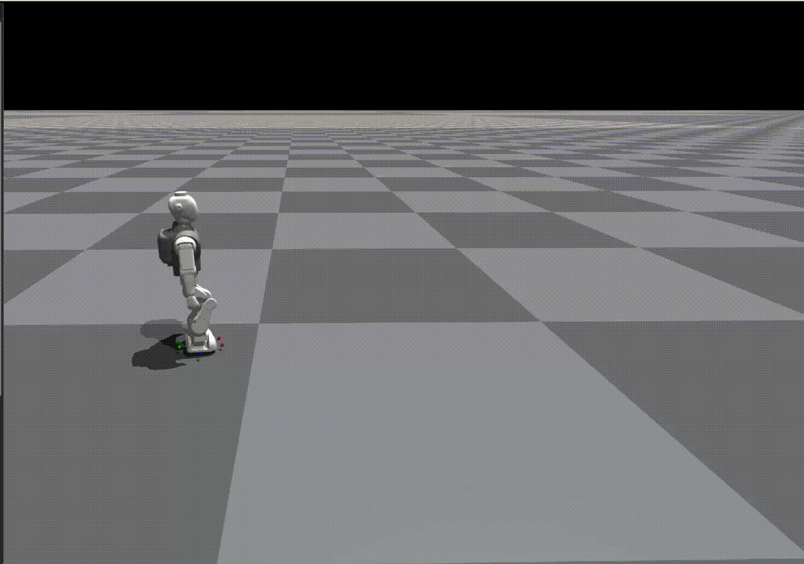
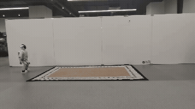

<div align="center">
  <h1 align="center">JOYIN M1 RL GYM</h1>
</div>
  <p align="center">
    <span> 🇨🇳中文 </span> | <a href="README.md"> 🌎English </a>
  </p>
<p align="center">
  <strong>这是一个基于 JOYNIN M1 舵机机器人的强化学习baseline仓库</strong>
</p>

<div align="center">

<table>
  <tr>
    <td></td>
    <td></td>
  </tr>
</table>
</div>

## 1. 环境搭建：

### 1\.1 使用 Ubuntu 20\.04 / Ubuntu 22\.04 系统 ， 安装 miniconda / Anaconda

### 1\.2  创建一个虚拟环境

```Plain Text
conda create -n M1_env python=3.8
```

### 1\.3  安装显卡驱动

可以通过，ubuntu自带的驱动更新软件，选择合适的驱动即可，建议使用525以上版本


### 1\.4 依赖库安装

#### 1\.4\.1 Clone 项目并激活环境

```Plain Text
cd ~/
git clone https://cnb.cool/JOYIN_RL/JOYIN_MINI_GYM
conda activate M1_env
```

#### 1\.4\.2 安装Isaac Gym

Isaac Gym 是归属于 Nvidia 的物理仿真环境。

从 Nvidia 官网下载 Isaac Gym：[https://developer.nvidia.com/isaac-gym/download](https://developer.nvidia.com/isaac-gym/download)

```Plain Text
# clone项目并进入到项目目录
cd ~/JOYIN_MINI_GYM/

# 安装Isaac Gym
cd IsaacGym_Preview_4_Package/isaacgym/python/
pip install -e . -i https://mirrors.tuna.tsinghua.edu.cn/pypi/web/simple 
```

输入以下代码进行测试，如果出现窗口显示1080个球下落，则安装成功

```Plain Text
cd examples
python 1080_balls_of_solitude.py
```


#### 1\.4\.3 安装 rsl\_rl

```Plain Text
# 进入到项目目录
cd ~/JOYIN_MINI_GYM/

# 安装 rsl_rl
cd rsl_rl
pip install -e . -i https://mirrors.tuna.tsinghua.edu.cn/pypi/web/simple
```

#### 1\.4\.4 安装 legged\_gym

```Plain Text
# 进入到项目目录
cd ~/JOYIN_MINI_GYM/

# 安装 legged_gym
cd JOYIn_gym/
pip install -e . -i https://mirrors.tuna.tsinghua.edu.cn/pypi/web/simple
```

#### 1\.4\.4 安装 legged\_gym

```Plain Text
# 安装其他依赖
pip install tensorboard protobuf==3.20.3 
```

### 1\.5 训练测试

输入代码，开启训练，如果出现训练日志和图像，则训练框架安装成功。

```Plain Text
# 进入到项目目录
cd ~/JOYIN_MINI_GYM/

python JOYIn_gym/legged_gym/scripts/train.py --task=mini1_18dof_walk --num_envs=40

```

<div align="center">

<table>
  <tr>
    <td></td>
    <td></td>
  </tr>
</table>

</div>

### 1\.6 常见错误

如果出现以下错误，是因为conda环境中没有链接python3\.8库

```Plain Text
ImportError: libpython3.8.so.1.0: cannot open shared object file: No such file or directory
```

重新查找动态库存在路径

```Plain Text
find / -name "libpython3.8.so.1.0" 2>/dev/null
```

通过重新链接动态库即可解决，其中/path/to/lib为自己的动态库路径：

```Plain Text
export LD_LIBRARY_PATH=/path/to/lib:$LD_LIBRARY_PATH
```

## 2. 工程结构：

### 2\.1 JOYIN\_MINI\_GYM 主要结构

```Plain Text
├── IsaacGym_Preview_4_Package   # isaacgym 目录
├── JOYIn_gym                    # 主要工程目录
├── LICENSE                
├── README.md
└── rsl_rl                       # 强化学习算法库
```

### 2\.2 JOYIn\_gym 主要结构

```Plain Text
├── legged_gym                   # 主要环境配置文件
├── LICENSE
├── licenses
├── logs                         # 训练日志存放路径
├── resources                    # URDF存放路径，可以在里面添加自己的机器人
└── setup.py

```

### 2\.3 legged\_gym 主要结构

```Plain Text
├── envs                         # 环境参数配置
│   ├── base                     # 基础环境配置
│   ├── __init__.py
│   ├── mini1                    # 机器人训练参数配置，从base继承
│   └── __pycache__
├── __init__.py                  # 注册训练任务
├── __pycache__
│   └── __init__.cpython-38.pyc
├── scripts                      # 脚本存放位置
│   ├── play.py                  # 训练脚本
│   └── train.py                 # 回放脚本
└── utils
    ├── gym_math.py
    ├── helpers.py
    ├── __init__.py
    ├── logger.py
    ├── math.py
    ├── __pycache__
    ├── task_registry.py
    └── terrain.py               # 地形配置文件
```

## 3\.训练及部署流程：

一个完整的强化学习训练流程包含如下：调整训练参数\-\>训练\-\>回放\-\>simtosim\-\>simtoreal。

### 3\.1 调整训练参数

训练参数存放在 JOYIN\_MINI\_GYM/JOYIn\_gym/legged\_gym/envs/mini1 中，主要有两个文件，分别是

a\. mini\_code\.py: 训练函数文件。

b\. mini\_18dof\_walk\_config\.py：训练配置文件。

### 3\.2 开始训练

训练脚本存放在：JOYIN\_MINI\_GYM/JOYIn\_gym/legged\_gym/scripts 中，执行以下命令开始训练：

```Plain Text
python JOYIn_gym/legged_gym/scripts/train.py --task=mini1_18dof_walk --num_envs=4096 --headless
```

训练脚本参数如下：

```Plain Text
--task           # 训练任务，在envs/__init__中进行注册
--num_envs       # 环境数量
--headless       # 是否进行渲染，如果进行渲染可以按V停止渲染
--resume         # 是否从断点开始训练
--checkpoint     # 指定夹在模型文件  默认加载最新
--load_run       # 指定加载文件夹  -1 指定上次文件夹
```

通过tensorboard查看训练日志，日志存放路径 \~/JOYIN\_MINI\_GYM/JOYIn\_gym/logs/mini1\_18dof\_walk：

```Plain Text
tensorboard --logdir=~/JOYIN_MINI_GYM/JOYIn_gym/logs/mini1_18dof_walk --port=6008
```

在浏览器打开本地网页  http://localhost:6008/ 即可查看

### 3\.3 回放查看训练结果

回放脚本存放在：JOYIN\_MINI\_GYM/JOYIn\_gym/legged\_gym/scripts 中，执行以下命令开始回放（工程会带有一个训练好的model以供测试）：

```Plain Text
python JOYIn_gym/legged_gym/scripts/play.py --task=mini1_18dof_walk --num_envs=1
```


play脚本中存在 EXPORT_POLICY 参数，当他为True时，会在log底下生成用于部署的.pt和.onnx文件。

### 3\.4 sim\_to\_real 

sim\_to\_real 见部署工程文档


## 4\.致谢

本仓库开发离不开以下开源项目的支持与贡献，特此感谢：

- [Isaac Gym](https://developer.nvidia.com/isaac-gym): 高性能GPU物理仿真平台。

- [legged\_gym](https://github.com/leggedrobotics/legged_gym): 训练与运行代码。

- [rsl\_rl](https://github.com/leggedrobotics/rsl_rl.git): 强化学习算法库。


